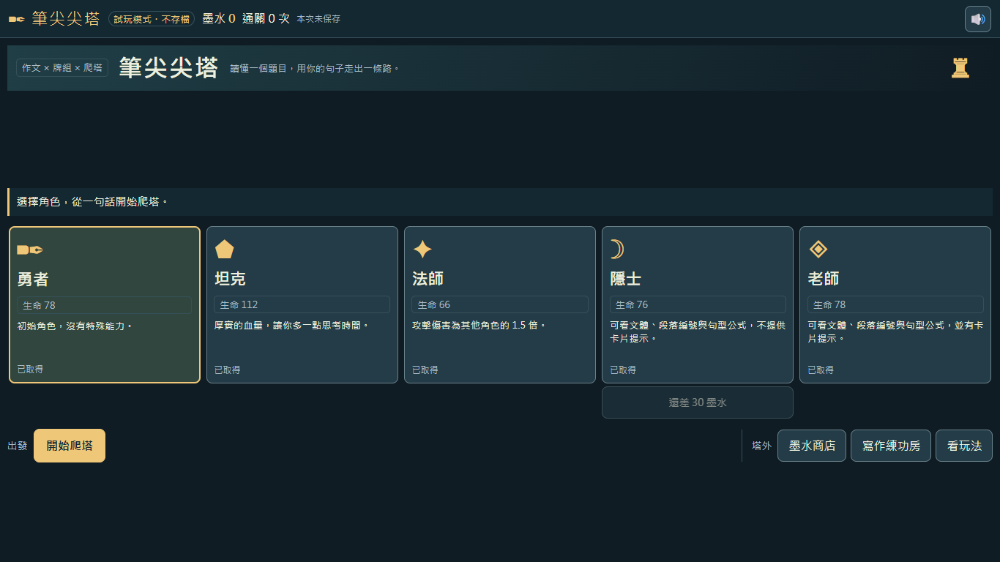
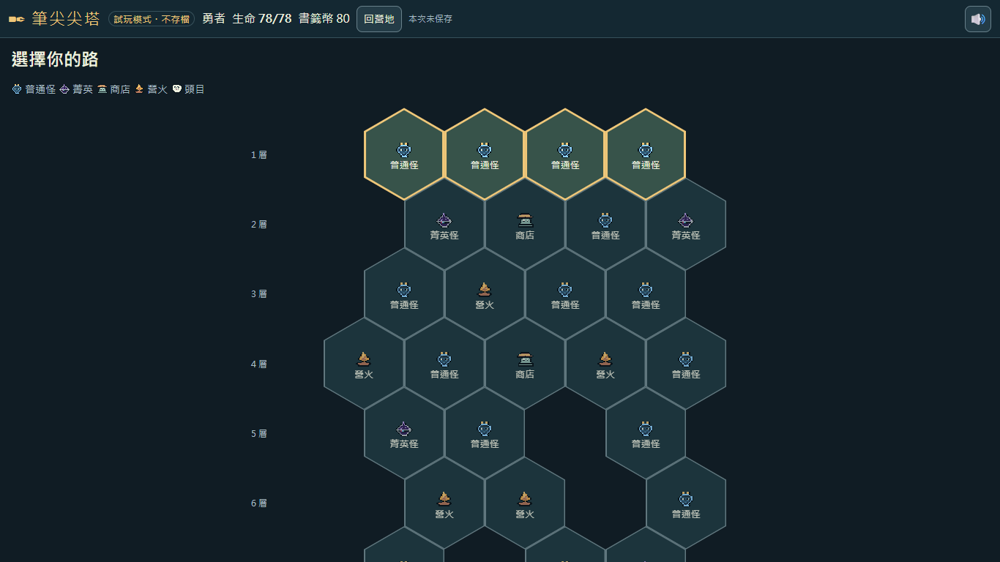
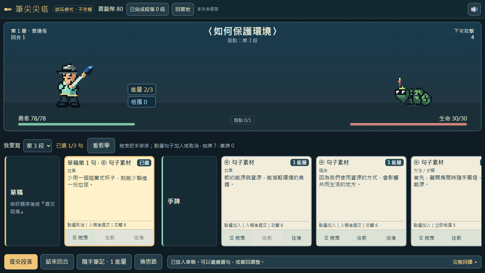
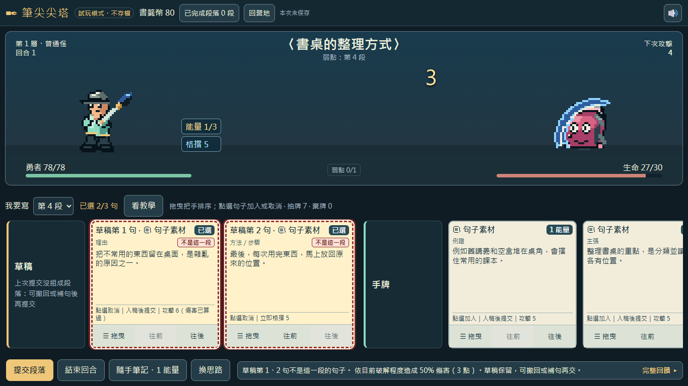
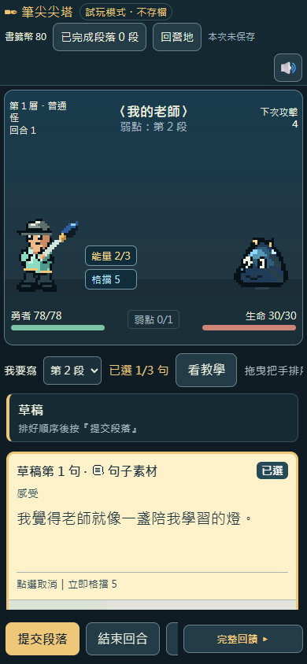
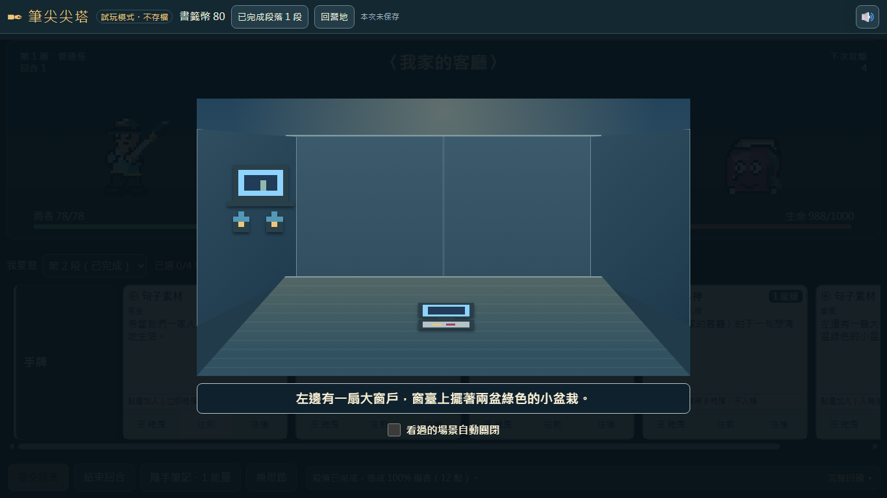
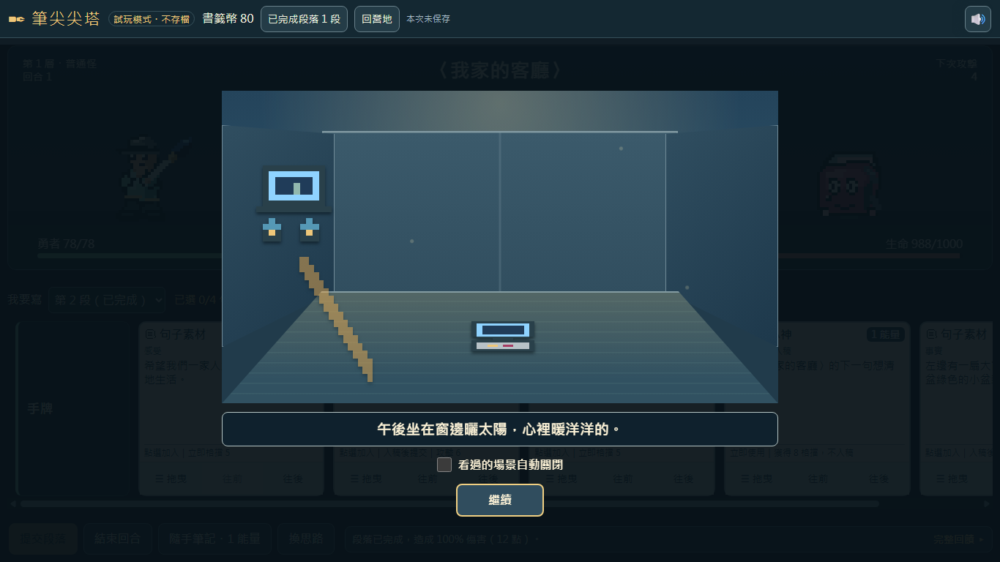
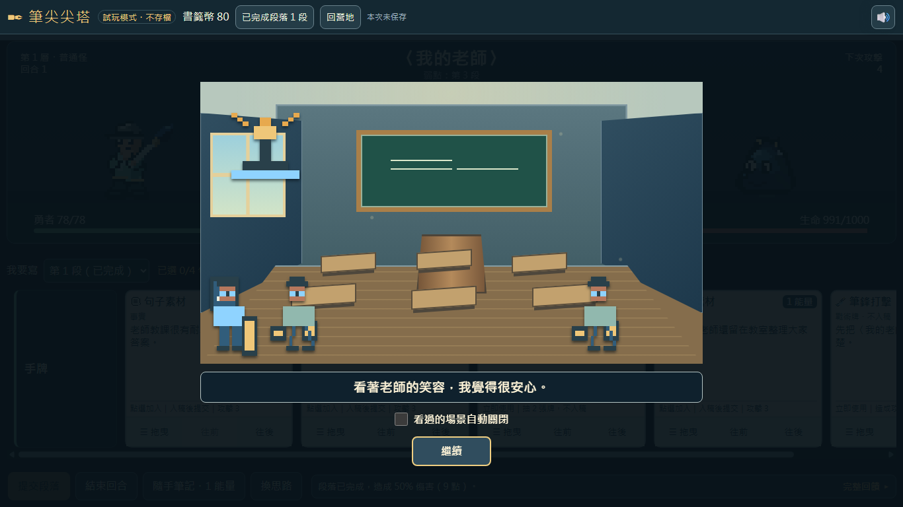
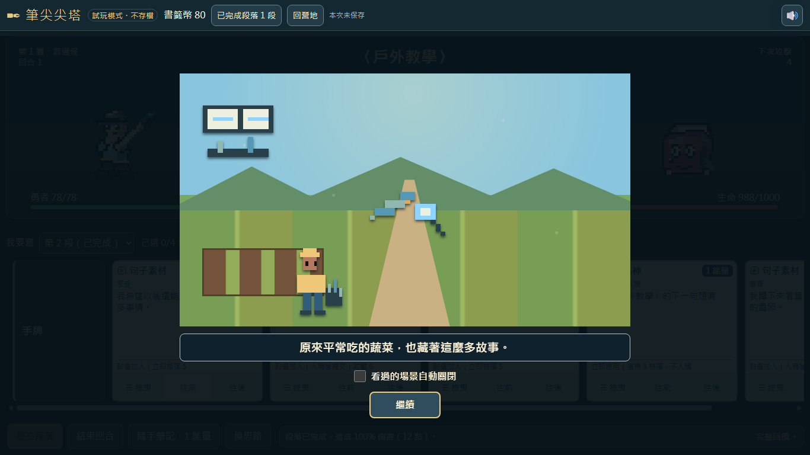

# 筆尖尖塔：作文卡牌爬塔遊戲

用寫作文的方式打怪爬塔。玩家讀懂題目，把同一題的句子卡排進草稿、組成段落，組對了就能對怪物造成傷害，一路爬到塔頂寫完整篇文章。

> 狀態：**開發中**。這是 2026-11-05 的版本，後續功能見下方「待開發」。

## 遊戲畫面

> 以下截圖用試玩模式（`?unlock=all`）拍攝，所以畫面左上角會顯示「試玩模式・不存檔」。每局的題目和手牌是隨機的，你玩到的內容會不一樣。

### 1. 選角色

五個角色各有特色：坦克血量多、法師傷害高；隱士和老師可以看到文體與句型提示，老師還會標出可以出的卡。下方「塔外」區可以進墨水商店買強化，或到寫作練功房練習排段落。

### 2. 爬塔地圖

一共 10 層，每次從亮起的格子選一條路往上爬。普通怪和菁英怪要打；營火可以回血，或升級、刪掉一張牌；商店可以買句子素材牌、戰術牌和遺物；最上面一層是頭目。

### 3. 戰鬥：把句子排成段落

- 上方是題目（例如〈如何保護環境〉）和怪物的**弱點**，也就是這回合要寫的段落。
- 點手牌裡的句子卡，它會進到左邊的**草稿**；可以拖曳或按「往前／往後」調整順序。
- 排好後按「提交段落」，組對了就能打出整段的傷害。每張卡最下面寫著它的效果，例如「攻擊 6」或「立即格擋 5」。

### 4. 放錯句子時的提示

如果草稿裡有不屬於這一段的句子，提交後：

- 下方回饋列會**列出全部放錯的位置**，例如「草稿第 1、2 句不是這一段的句子。」
- 放錯的卡片會加上**紅色虛線外框**和「不是這一段」標籤，一眼就知道要撤回哪幾張。
- 提示只說「不是這一段」，不會說出它屬於第幾段，讓玩家自己想。
- 草稿會保留，可以撤回錯的句子或補句後再交；這次仍會依目前組對的程度造成部分傷害。

### 5. 手機直式畫面

手機上一樣可以玩：戰場縮小在上方，卡片改成直向排列，「提交段落」和「結束回合」固定在畫面最下方。

### 6. 交出段落，看見你寫的畫面（2026-11-05 新增）

提交段落後，會跳出這個題目的場景，**依照草稿卡的順序，一件一件出現句子寫到的東西**，下方同時顯示那一句原文。每件停留 2 秒，也可以點一下畫面、按 Enter 或空白鍵，直接看下一件。

- 事實句帶出看得到的東西（電視、窗戶、盆栽）；感受句帶出氣氛（溫暖的陽光、愛心、星光）。
- 寫對了，畫面會變得溫暖明亮；放錯段落時，畫面照樣播放，下方提示「草稿保留，可再修改」。
- **第一次看到某一段的場景要按「繼續」才會關閉**，讓玩家有時間看完。看過的場景，可以勾選「看過的場景自動關閉」，之後就會自動收起。這個紀錄只存在這台電腦的瀏覽器裡。
- 畫面只顯示你交出去的句子，不會透露正確答案、第幾段或文體。

### 7. 不同題目，不同舞台

記敘文 6 題都有自己的舞台：〈我家的客廳〉是客廳，〈我的老師〉〈一個勇敢的人〉是教室，〈美麗的校園〉〈一件特別的事〉是校園外景，〈戶外教學〉是農場。說明文與議論文的題目目前還沒有場景。

上面的教室畫面是〈我的老師〉第一段。這一段照教學動畫〈一段裡面怎麼排？〉的示範，改成**四句**：先寫身材、五官、服裝三個事實，最後寫感受。

## 怎麼玩

1. 下載 `game/index.html`，用 Chrome 或 Edge 直接雙擊開啟。不需要安裝，離線也能玩（只有「看教學」動畫需要連網）。
2. 選角色 → 選地圖上亮起的格子 → 戰鬥時把句子卡點進草稿、排好順序 → 提交段落。
3. 進度存在瀏覽器本機；換電腦或清除瀏覽資料後，進度不會保留。

試玩網址參數：

- `index.html?unlock=all`：五個角色全部解鎖的試玩模式，**不存檔**。
- `index.html?auto=1`：可以看自動示範一局。
- `index.html?unlock=all&topic=teacher`：試玩模式，而且每場戰鬥都用指定題目。題目代號：`teacher` 我的老師、`pencil` 我家的客廳、`campus` 美麗的校園、`trip` 戶外教學、`brave` 一個勇敢的人、`special` 一件特別的事、`desk` 書桌的整理方式、`environment` 如何保護環境、`reading` 讀書的重要、`humility` 談謙虛、`book` 一本書的啟示。

## 目前功能

- **五個角色**：勇者、坦克、法師、隱士、老師。隱士與老師可以看到文體與句型提示，老師還會標出可以出的卡。
- **隨機爬塔地圖**：普通怪、菁英、營火、商店，最後是頭目。
- **戰鬥**：普通怪、菁英要組出指定段落（弱點）；頭目要依序寫完四段。
- **墨水商店（局外成長）**：用墨水購買四條成語強化，每條三階：
  - 攻擊：一針見血、入木三分、力透紙背
  - 防禦：有備無患、銅牆鐵壁、固若金湯
  - 能量：精神抖擻、生龍活虎、文思泉湧
  - 墨水：積少成多、日積月累、聚沙成塔
- **寫作練功房**：段落排序練習，首次完成可得墨水。
- **像素美術**：角色、怪物與圖示都是程式內的像素圖，沒有外部圖檔。
- **8-bit 音樂與音效**：用瀏覽器即時合成，沒有音檔。預設音樂關、音效開，右上角喇叭按鈕可以調整。
- **戰敗後看教學再挑戰**：戰敗時可以看對應的教學動畫，然後復活一次。
- **卡關鷹架**（勇者、坦克、法師）：提交失敗時說出原因；同一段失敗兩次，提醒去看教學動畫（這次免費）；看過後還是失敗，就顯示這段的句數與句型順序。用到提示的那一關，墨水會依提示程度打折。
- **段落情境**（記敘文 6 題）：提交段落後，依草稿順序一件一件出現句子寫到的東西；第一次看要按「繼續」，看過的可以設定自動關閉。
- **草稿上限**：所有角色、所有段落都一樣，等於最長那一段的句數（目前 4 句），不會因為段落不同而透露句數。
- **題目與教學動畫對齊**：11 個題目的分段與段內句子順序，都和「看教學」動畫的示範一致（例如狀物題〈我家的客廳〉照動畫的方位順序分段）。

## 檔案

| 路徑 | 內容 |
|---|---|
| `game/index.html` | 遊戲本體（單一檔案） |
| `art/pixel-preview.html` | 像素美術素材總覽 |
| `spec.md` | 遊戲規格與設計裁決 |
| `course-coverage.md` | 25 課作文教材與遊戲題材的對照 |
| `layout-plan.json`、`layout-preview.svg` | 戰鬥畫面版面規劃 |
| `tests/game.test.mjs` | 自動測試，執行 `node --test tests/game.test.mjs`（需要 Node.js 20 以上） |
| `tests/browser-check.mjs` | 開發用的瀏覽器檢查腳本（依賴開發環境的資料夾結構，一般玩家不需要） |
| `docs/screenshots/` | README 用的遊戲截圖（01～05 為 2026-11-01、06～09 為 2026-11-05 拍攝） |

## 待開發

- **成語搭配牌**：寫感受段時，可以把情緒和成語組合，例如「難過」搭配「悲痛欲絕」「肝腸寸斷」；景物描寫也有可以搭配的成語。
- **老師端**：查看學生的遊玩紀錄與分析。

## 教學動畫來源

「看教學」會開啟作文教學動畫網站：https://bai-collab.github.io/pyes_Composition/
